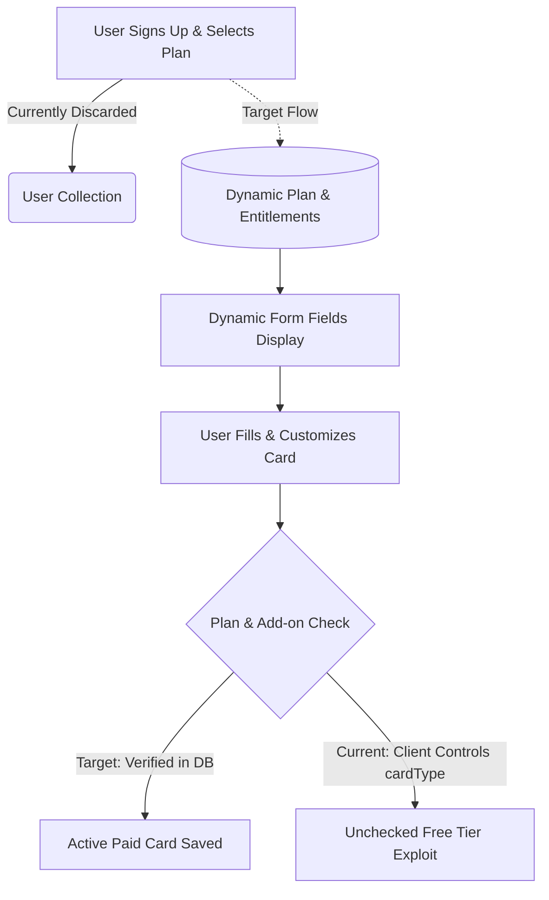

# DigiCard Platform: Architecture Review & Engineering Task Backlog

> **Repositories Reviewed**: 
> * Frontend: `https://github.com/digicard2026/digicard-frontend.git` (Branch: `feature/changeUi`)
> * Backend: `https://github.com/digicard2026/digicard-backend.git` (Branch: `feature/changeUi`)

---

## Executive Summary

The DigiCard platform has transitioned through several template iterations (Hospital Management System backend, TailAdmin frontend, UConnect telephony dialer). While recent commits on `feature/changeUi` added visual cards and form fields for 8 plans and 13 add-ons, **the underlying database architecture, payment verification, and API security remain fundamentally disconnected from this business workflow**.



---

## 1. Core Workflow Gap: Plans, Field Gating & Add-ons

### 1.1 The Issue
The intended user flow is:
1. User selects a plan (e.g., Personal, Business, Professionals, etc.).
2. The user sees and fills only the fields applicable to that plan.
3. In the future, the user can select add-ons (NFC cards, photo galleries, virtual numbers, appointment booking), pay for them, and unlock those features.

### 1.2 Current Architecture vs. Required Target

| Component | Current State (`feature/changeUi`) | Required Target Architecture |
| :--- | :--- | :--- |
| **`Plan` Model** | `src/models/plan.model.js`: Only stores 3 outdated categories (`personal`, `business`, `business premium`). Zero knowledge of fields, features, or limits. | Dynamic collection storing all 8 plans with `allowedFields: []`, `features: []`, `limits: {}`, and `pricing: []`. |
| **Field Gating** | Hardcoded in static JS files: `src/config/cardFieldsConfig.js` (BE) and `PlanSelection.jsx` (FE). | Frontend queries `GET /api/v1/plans/:id` and dynamically renders allowed fields from the DB. |
| **Signup Flow** | `src/services/user-service.js`: Ignores `selectedPlan` during user creation; drops `selectedAddons`. | Registration initializes a `UserSubscription` with a trial/pending record for the chosen plan and add-ons. |
| **Card Ownership & Security** | `src/models/card.model.js`: No `userId` or `subscriptionId`. Reads `cardType` and `addons` directly from client JSON. Free access exploit. | Card enforces foreign keys (`userId`, `subscriptionId`). Server rejects fields exceeding paid entitlements. |
| **Add-ons** | Cosmetic boolean map in `Card` (`addons: { gallery: Boolean, ... }`). No pricing, catalog, or payment verification. | Dedicated `Addon` catalog collection with pricing, billing rules (`one_time`/`recurring`), and quota grants. |

---

## 2. Target Database Schema Specifications

### 2.1 Dynamic `Plan` Model
```javascript
// src/models/plan.model.js
const mongoose = require('mongoose');

const PlanSchema = new mongoose.Schema({
  code: { 
    type: String, 
    required: true, 
    unique: true, 
    enum: [
      'Personal', 'Business', 'BusinessPremium', 'Professionals', 
      'Entrepreneurials', 'EntrepreneurialsMulti', 'CorporateBusiness', 'MiniWebsite'
    ] 
  },
  name: { type: String, required: true },
  subtitle: { type: String },
  category: { type: String, enum: ['individual', 'business'], required: true },
  badge: { type: String, default: null },
  description: { type: String },
  pricing: [{
    duration: { type: String, enum: ['monthly', 'six_months', 'yearly'], required: true },
    durationDays: { type: Number, required: true },
    price: { type: Number, required: true },
    currency: { type: String, default: 'INR' }
  }],
  allowedFields: [{ type: String }], // ['profilePhoto', 'phones', 'websites', 'services', ...]
  features: [{ type: String }],      // Feature bullet points displayed in UI
  limits: {
    maxGalleryImages: { type: Number, default: 0 },
    maxVideos: { type: Number, default: 0 },
    maxDownloads: { type: Number, default: 0 },
    allowCustomSlug: { type: Boolean, default: false }
  },
  isActive: { type: Boolean, default: true }
}, { timestamps: true });

module.exports = mongoose.model('Plan', PlanSchema);
```

### 2.2 `Addon` Catalog Model
```javascript
// src/models/addon.model.js
const mongoose = require('mongoose');

const AddonSchema = new mongoose.Schema({
  code: { type: String, required: true, unique: true }, // 'gallery', 'nfcCard', 'docsBuilder', 'leadGen'
  name: { type: String, required: true },
  description: { type: String },
  price: { type: Number, required: true },
  currency: { type: String, default: 'INR' },
  billingType: { type: String, enum: ['one_time', 'recurring'], required: true },
  compatiblePlans: [{ type: String }], // ['Business', 'Professionals', 'CorporateBusiness']
  entitlementGrant: {
    unlocksFields: [{ type: String }], // e.g. ['gallery']
    bonusQuotas: {
      maxGalleryImages: { type: Number, default: 0 },
      maxVideos: { type: Number, default: 0 }
    }
  },
  isActive: { type: Boolean, default: true }
}, { timestamps: true });

module.exports = mongoose.model('Addon', AddonSchema);
```

### 2.3 Unified `UserSubscription` Model
```javascript
// src/models/user-subscription.model.js
const mongoose = require('mongoose');

const UserSubscriptionSchema = new mongoose.Schema({
  userId: { type: mongoose.Schema.Types.ObjectId, ref: 'User', required: true },
  planId: { type: mongoose.Schema.Types.ObjectId, ref: 'Plan', required: true },
  planCode: { type: String, required: true },
  status: { 
    type: String, 
    enum: ['active', 'trial', 'past_due', 'cancelled', 'expired'], 
    default: 'trial' 
  },
  startDate: { type: Date, required: true },
  endDate: { type: Date, required: true },
  
  purchasedAddons: [{
    addonId: { type: mongoose.Schema.Types.ObjectId, ref: 'Addon', required: true },
    addonCode: { type: String, required: true },
    purchaseDate: { type: Date, default: Date.now },
    expiresAt: { type: Date }, // null for one-time purchases (e.g. NFC Card)
    paymentId: { type: String },
    status: { type: String, enum: ['active', 'expired'], default: 'active' }
  }],

  amountPaid: { type: Number, default: 0 },
  paymentId: { type: String }
}, { timestamps: true });

module.exports = mongoose.model('UserSubscription', UserSubscriptionSchema);
```

### 2.4 Updated `Card` Model
```javascript
// src/models/card.model.js (Excerpt)
const cardSchema = new mongoose.Schema({
  userId: { type: mongoose.Schema.Types.ObjectId, ref: 'User', required: true },
  subscriptionId: { type: mongoose.Schema.Types.ObjectId, ref: 'UserSubscription', required: true },
  cardType: { type: String, required: true },
  
  // Card content fields...
  // Dynamic features (only saved if user's subscription + active addons entitle them)
}, { timestamps: true });
```

---

## 3. Prioritized Engineering Task Backlog

### Phase 0: Critical Security & Secret Hygiene (Days 1–2)
- [ ] **Task 0.1: Rotate Secrets & Remove `.env` from Git Tracking**
  - Files: `.gitignore` and `.env` in both repos.
  - Actions: Rotate Azure Blob Storage keys, MongoDB Atlas passwords, SMTP mail passwords, Razorpay secrets, and JWT secrets. Add `.env` and `.env.*` to `.gitignore`. Run `git rm --cached .env` and commit.
- [ ] **Task 0.2: Fix Unauthenticated Privilege Escalation**
  - Files: `src/routes/user-routes.js`, `src/controllers/user-controller.js`
  - Actions: Add `authMiddleware` to `PATCH /api/v1/user/:id`. Restrict role modification to users where `req.user.role === 'admin'`.
- [ ] **Task 0.3: Protect Admin, Card, and Franchise Routes (IDOR Prevention)**
  - Files: `src/routes/admin-routes.js`, `src/routes/card-routes.js`, `src/routes/franchisePartner-routes.js`
  - Actions: Enforce authentication on all mutation routes. In card controllers, verify `card.userId === req.user.id` before allowing updates or deletes. Stop public exposure of `GET /get-all-cards`.

---

### Phase 1: Database Normalization & Business Logic (Week 1)
- [ ] **Task 1.1: Deploy Dynamic `Plan` Model & Migration Seed**
  - Files: `src/models/plan.model.js`, `src/scripts/seedPlans.js`
  - Actions: Implement the new `Plan` schema above. Migrate the 8 plans from `cardFieldsConfig.js` into MongoDB. Add `GET /api/v1/plans` endpoint.
- [ ] **Task 1.2: Implement `Addon` Catalog & Payment Verification**
  - Files: `src/models/addon.model.js`, `src/routes/addon-routes.js`, `src/controllers/addon-controller.js`
  - Actions: Create `Addon` collection. Seed 13 add-ons with prices and quota grants. Validate that client-submitted add-ons exist in `subscription.purchasedAddons` before saving.
- [ ] **Task 1.3: Unify Subscriptions & Enforce Server-Side Entitlement Checks**
  - Files: `src/models/user-subscription.model.js`, `src/controllers/card-controller.js`
  - Actions: Consolidate `SubscriptionPlan` and `UserSubscription`. In `card-controller.js`, validate submitted fields against `subscription.planId.allowedFields` rather than trusting unverified `cardDetails.cardType`.
- [ ] **Task 1.4: Persist Selected Plan & Add-ons on Signup**
  - Files: `src/pages/Authentication/SignUp.jsx` (FE), `src/services/user-service.js` (BE)
  - Actions: Include `selectedPlan` and `selectedAddons` in signup payload. Initialize `UserSubscription` upon user registration.

---

### Phase 2: Media Storage & Upload Architecture (Week 2)
- [ ] **Task 2.1: Replace 50MB Base64 Payloads with Direct Azure Blob Uploads**
  - Files: `src/utils/azure-base64-uploader.js`, `index.js`
  - Actions: Implement Azure Blob SAS Token generation endpoint (`POST /api/v1/storage/sas-token`). Client uploads files directly to Azure Blob and sends only URLs to Node.js. Remove fallback that writes raw base64 to MongoDB documents. Lower `express.json({ limit })` to `2mb`.

---

### Phase 3: Frontend Decomposition & Cleanup (Weeks 2–3)
- [ ] **Task 3.1: Decompose `CreateCard.jsx` Monolith (10,480+ Lines)**
  - File: `src/pages/Card/CreateCard.jsx`
  - Actions: Break into step components (`StepBasicInfo.jsx`, `StepContactDetails.jsx`, `StepBusinessDetails.jsx`, `StepMediaUploads.jsx`, `StepInteractiveFeatures.jsx`, `CardPreviewPane.jsx`). Manage state with a dedicated React Context or Zustand store.
- [ ] **Task 3.2: Purge 5,000+ Lines of Dead Commented Code**
  - Files: `AdminDashBoard.jsx`, `SignupForm.jsx`, `FranchisedashBoard.jsx`, `App.jsx`
  - Actions: Delete dead commented-out code blocks and remove unused `UConnect` telephony routes/dependencies (`jssip`).
- [ ] **Task 3.3: Fix Runtime Crashes in `userApi.js` & Standardize API Client**
  - File: `src/service/userApi.js`
  - Actions: Fix `ReferenceError: page is not defined` on lines 80 and 184. Implement a centralized Axios instance with `baseURL` and `withCredentials: true`.

---

### Phase 4: DevOps & Containerization (Week 3)
- [ ] **Task 4.1: Production Dockerfile & `.dockerignore`**
  - File: `Dockerfile`
  - Actions: Switch `CMD ["npm", "start"]` (nodemon) to `CMD ["node", "index.js"]`. Add `.dockerignore` to exclude `.git`, `.env`, and `node_modules` from build layers.
