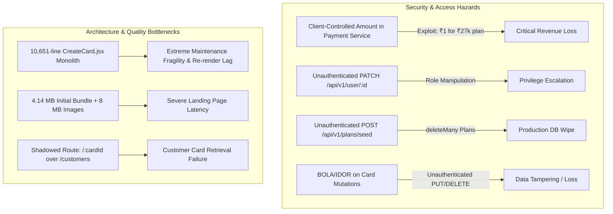
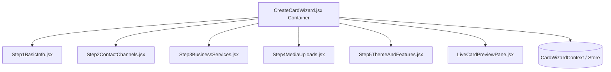
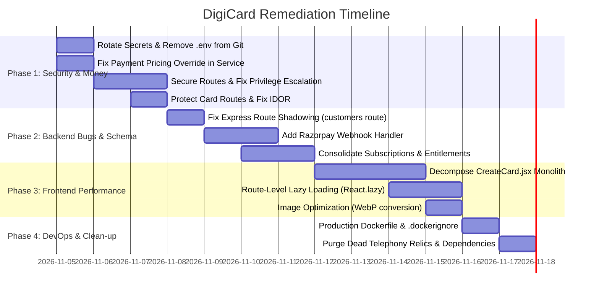

# DigiCard Platform: Comprehensive Code & Architecture Review
**Repositories**: `digicard-be` (`feature/di-service-providers-backend`) & `digicard-fe` (`feature/di-service-providers-refinement`)  
**Review Scope**: Security, Architecture, Correctness, Performance, Code Health & Integration Contracts  
**Platform**: Revayah One / DigiCard Digital Identity Platform

---

## Executive Summary

The DigiCard platform provides digital identity business cards (individual, business, and service provider tiers) featuring dynamic plan field gating, modern responsive card templates (`Default`, `Modern`, `Dark`, `Light`, `ModernCard2`), and vCard 3.0 contact generation.

However, both repositories have accumulated significant technical debt from previous project iterations (**Hospital Management System** on backend, **TailAdmin + UConnect Telephony Dialer** on frontend). More critically, the system contains several **P0 security vulnerabilities**—including client-controlled payment pricing, unauthenticated privilege escalation, plaintext secret leakage, and unrestricted database wipe endpoints—alongside severe frontend bundle bloat (**4.14 MB single JS bundle**) and a **10,651-line monolithic component** (`CreateCard.jsx`).



---

## 1. Vulnerability & Security Findings (P0 - Critical)

### 1.1 Arbitrary Price Manipulation in Payment Service
* **File**: `digicard-be/src/services/payment-service.js` (Lines 198–201)
* **Code Issue**:
  ```javascript
  // If client supplied recalculation amount (> 0), honor it; otherwise use computed price
  const finalPrice = (clientAmount && Number(clientAmount) > 0)
    ? Number(clientAmount)
    : computedFinalPrice;
  ```
* **Risk**: High / Exploitable. Any client or attacker sending `{ "planName": "MiniWebsite", "billingCycle": "yearly", "amount": 1 }` forces the backend to create a Razorpay order for ₹1 instead of the computed ₹27,000. Once Razorpay completes, the subscription is activated at the enterprise tier for ₹1.
* **Remediation**: Remove `clientAmount` override entirely. Pricing must always be computed strictly on the server from the `Plan` and `Addon` models.

---

### 1.2 Unauthenticated Subscription & Plan Manipulation
* **File**: `digicard-be/src/routes/subscription-routes.js` (Line 23) & `src/controllers/subscription-controller.js` (Lines 130–152)
* **Code Issue**:
  ```javascript
  router.post("/update-user-plan", updateUserPlan); // Lacks authMiddleware!
  ```
  The handler accepts `email`, `planName`, `billingCycle`, and `selectedAddons` from the request body and directly upgrades the user's subscription in MongoDB without checking authentication, payment status, or admin rights.
* **Risk**: Allows anyone on the public internet to grant any user account an active subscription with any tier or add-on.
* **Remediation**: Guard `/update-user-plan` with `auth` and `isAdmin` middleware, or restrict subscription updates exclusively to verified payment verification handlers.

---

### 1.3 Unauthenticated Production Database Wipe Endpoint
* **File**: `digicard-be/src/routes/plan-route.js` (Lines 7–21)
* **Code Issue**:
  ```javascript
  router.post("/seed", async (req, res) => {
    try {
      const defaultPlans = buildPlanDocuments();
      await Plan.deleteMany({}); // DROPS ALL PLANS IN DATABASE!
      const result = await Plan.insertMany(defaultPlans);
  ```
* **Risk**: Unauthenticated POST endpoint that deletes all records in the `plans` collection. A single rogue HTTP request wipes all plans and breaks relational references across existing cards and subscriptions.
* **Remediation**: Protect with `auth, isAdmin` or restrict execution strictly to CLI deployment scripts (`npm run seed:plans`).

---

### 1.4 Unauthenticated Role Tampering & Privilege Escalation
* **File**: `digicard-be/src/routes/user-routes.js` (Line 23) & `src/controllers/user-controller.js` (Lines 439–485)
* **Code Issue**:
  ```javascript
  router.patch("/:id", userController.updateUserRoleAndComplete); // Lacks auth!
  ```
  In `user-controller.js`, the check `if (!req.user || req.user.role !== "admin")` is only evaluated when `role === "admin"`. Because `authMiddleware` is omitted on the route, `req.user` is never populated. Any unauthenticated caller can alter roles to `partner`, `franchise`, or `customer`, or set `registrationComplete: true`. Additionally, legitimate admins cannot promote users to admin because `req.user` is undefined.
* **Remediation**: Attach `auth` middleware to `PATCH /:id` and ensure role modifications require administrative authorization.

---

### 1.5 Broken Object-Level Authorization (BOLA / IDOR) on Cards
* **File**: `digicard-be/src/routes/card-routes.js` & `src/controllers/card-controller.js`
* **Vulnerable Routes**:
  - `PUT /update-card/:cardId`
  - `PUT /update-by-email/:email`
  - `DELETE /delete-card/:cardId`
  - `DELETE /delete-by-email/:email`
  - `GET /get-all-cards`
* **Code Issue**: None of these routes apply authentication or verify card ownership (`card.createdBy.toString() === req.user.id`).
* **Risk**: Any caller knowing a card ID or email can modify or delete another user's business card, or dump all cards stored in the database.
* **Remediation**: Require `auth` middleware and enforce owner verification:
  ```javascript
  const card = await Card.findById(cardId);
  if (!card) return res.status(404).json({ message: "Card not found" });
  if (card.createdBy?.toString() !== req.user.id && req.user.role !== "admin") {
    return res.status(403).json({ message: "Forbidden: You do not own this card" });
  }
  ```

---

### 1.6 Plaintext Database Password in Stdout & Git Tracking of `.env`
* **File**: `digicard-be/src/config/db.js` (Line 8)
* **Code Issue**:
  ```javascript
  console.log(process.env.DB_URL); // Dumps full MongoDB Atlas URI with password to stdout!
  ```
* **Git Index**: `.env` is currently tracked in the Git index of both `digicard-be` and `digicard-fe` (`git ls-files .env` returns `.env`), exposing production credentials.
* **Dockerfile**: Missing `.dockerignore` causes `.env` and `node_modules` to be packaged into Docker container layers during `COPY . .`.
* **Remediation**:
  1. Remove `console.log(process.env.DB_URL);`.
  2. Untrack `.env`: `git rm --cached .env` in both repos.
  3. Create `.dockerignore` excluding `.env`, `.git`, and `node_modules`.
  4. Rotate MongoDB passwords, JWT secrets, Azure connection strings, and Razorpay secrets.

---

## 2. Functional Bugs & Routing Defects (P1 - High)

### 2.1 Express Route Shadowing Bug on Customer Cards
* **File**: `digicard-be/src/routes/card-routes.js` (Lines 66–68)
* **Code Issue**:
  ```javascript
  // Keep this LAST - Get card by ID
  router.get('/:cardId', cardController.getCardById);
  router.get("/customers/by-user/:userId", cardController.getCustomerByUserId);
  ```
* **Impact**: In Express, route patterns are evaluated in registration order. Requests to `/api/v1/card-routes/customers/by-user/:userId` match `/:cardId` with `cardId = "customers"`. The controller executes `Card.findById("customers")`, which throws a `CastError` or returns 404. `getCustomerByUserId` is unreachable.
* **Fix**: Move `router.get("/customers/by-user/:userId", ...)` **above** `router.get('/:cardId', ...)`.

---

### 2.2 Slug vs. ObjectId Ambiguity in Frontend Card Preview
* **File**: `digicard-fe/src/pages/Card/PreviewCard.jsx` (Lines 58–63)
* **Code Issue**:
  ```javascript
  if (identifier.length === 24) {
    url = `${CARD_URL}/${identifier}`;
  } else {
    url = `${CARD_URL}/share/${identifier}`;
  }
  ```
* **Impact**: If a user creates a 24-character custom URL slug (e.g., `sarah-connor-law-office` or `john-smith-consulting-in`), the frontend mistakenly treats it as a MongoDB ObjectId and requests `GET /api/v1/card-routes/:cardId`, crashing with `Cast to ObjectId failed`.
* **Fix**: Validate using a strict hexadecimal regex:
  ```javascript
  const isMongoId = /^[0-9a-fA-F]{24}$/.test(identifier);
  const url = isMongoId ? `${CARD_URL}/${identifier}` : `${CARD_URL}/share/${identifier}`;
  ```

---

### 2.3 Broken Public Card Viewer (`PublicCard.jsx`)
* **File**: `digicard-fe/src/pages/Card/PublicCard.jsx` (Lines 10–13)
* **Code Issue**:
  ```javascript
  useEffect(() => {
    const card = JSON.parse(localStorage.getItem("publicCard"));
    setPublicCard(card);
  }, []);
  ```
* **Impact**: The `/card/public` page attempts to read card details from the viewer's local browser storage. External visitors viewing a shared link have empty `localStorage`, resulting in "No public card selected".
* **Fix**: Accept a `:urlSlug` parameter and fetch card data from the public endpoint `GET /api/v1/card-routes/share/:urlSlug`.

---

### 2.4 Unhandled Razorpay Webhooks
* **File**: `digicard-be/src/routes/payment-routes.js`
* **Issue**: Payment verification currently relies entirely on frontend callback execution (`POST /api/v1/payments/verify-and-activate`). If the client loses connectivity, navigates away, or closes the popup after completing payment at Razorpay, the order is marked paid at the gateway but the user subscription remains `pending`.
* **Fix**: Implement an idempotent Razorpay webhook handler listening for `payment.captured` and `order.paid` events verified via HMAC signature.

---

### 2.5 Duplicate & Conflicting Subscription Models
* **Files**: `digicard-be/src/models/subscriptionPlan.model.js` and `src/models/user-subscription.model.js`
* **Issue**: The system maintains two separate schemas: `SubscriptionPlan` (temporary order records) and `UserSubscription` (active user entitlements). This dual-model design leads to desynchronization where `purchasedAddons` and `unlockedFields` exist in one document but not the other.
* **Fix**: Consolidate into a single `UserSubscription` model with lifecycle statuses (`pending_payment`, `active`, `past_due`, `expired`, `cancelled`).

---

### 2.6 Zombie Auth Controller & Misleading Routes
* **File**: `digicard-be/src/controllers/auth-controller.js` (Lines 25–41)
* **Issue**: `authController.signIn` has its JWT generation commented out and returns `{ message: "User signed in successfully" }` without returning a token or setting a cookie. Meanwhile, `userController.verifyUser` is the actual authentication handler.
* **Fix**: Consolidate all authentication into `authController` and deprecate dead handlers.

---

## 3. Frontend Architecture & Performance (P1 - High)

### 3.1 The 10,651-Line `CreateCard.jsx` Monolith
* **File**: `digicard-fe/src/pages/Card/CreateCard.jsx` (531 KB)
* **Breakdown**:
  - Lines 1–5557: 5,557 lines of commented-out dead legacy code.
  - Lines 5558–11720: 6,162 lines of monolithic state, wizard step rendering, file upload base64 handlers, plan gating, and inline styles.
* **Consequences**:
  - Severe typing latency and input re-rendering across steps.
  - State loss risk on minor component updates.
  - High risk of regression during code edits.
* **Recommended Component Decomposition**:



---

### 3.2 Huge 4.14 MB Un-Split Production Bundle
* **Build Metric**: `dist/assets/index-DRY7x3IQ.js` is **4,144 kB** (minified) / **1,140 kB** (gzip).
* **Cause**: `digicard-fe/src/App.jsx` imports over 70 page components statically. Every route—including legacy UConnect telephony pages, admin dashboards, partner portals, and charts—is bundled into the initial page load.
* **Fix**: Apply `React.lazy()` and `Suspense` across route boundaries:
  ```javascript
  const CreateCard = React.lazy(() => import('./pages/Card/CreateCard'));
  const AdminDashBoard = React.lazy(() => import('./pages/Dashboard/AdminDashBoard'));
  const PreviewCard = React.lazy(() => import('./pages/Card/PreviewCard'));
  ```

---

### 3.3 Heavy Unoptimized Image Assets (>8 MB)
* **Files**:
  - `revayah-logo-light.png`: **2.10 MB**
  - `schools_institutions.jpg`: **914 KB**
  - `resume-builder.png`: **836 KB**
  - `business_industry.jpg`: **803 KB**
  - `house_of_revayah_mountains.jpg`: **754 KB**
  - `partner-program.png`: **704 KB**
  - `female_doctor_tablet.jpg`: **616 KB**
* **Impact**: Total initial image payload exceeds 8 MB, severely degrading mobile Largest Contentful Paint (LCP).
* **Fix**: Convert images to WebP/AVIF format with 80% compression and serve responsive image srcset (`<picture>` or `vite-plugin-image-optimizer`).

---

### 3.4 Runtime `ReferenceError` Crashes in `userApi.js`
* **File**: `digicard-fe/src/service/userApi.js` (Lines 80 & 184)
* **Code Issue**:
  ```javascript
  // Line 80:
  const response = await fetch(`${USER_URL}/?page=${page+1}&limit=10`, GET_METHOD_NO_AUTH);
  // Line 184:
  const response = await fetch(`${PRODUCT_URL}/?page=${page+1}&limit=10`, GET_METHOD_NO_AUTH);
  ```
  `page` is not defined in scope or passed as a parameter. Calling either function throws `ReferenceError: page is not defined`. Additionally, `PRODUCT_URL` targets an unmounted backend route.

---

### 3.5 Client-Side Role Bypass in `ProtectedRoute.jsx`
* **File**: `digicard-fe/src/utility/ProtectedRoute.jsx` (Lines 8–12)
* **Code Issue**:
  ```javascript
  const effectiveRole = reduxRole || localStorage.getItem('role') || localStorage.getItem('user_role') || '';
  if (!allowedRoles.includes(effectiveRole)) {
    return <Navigate to="/" replace />;
  }
  ```
* **Issue**: Any visitor typing `localStorage.setItem('role', 'admin')` in browser DevTools immediately bypasses frontend route guards and views admin dashboard screens.
* **Fix**: Route protection should verify role claims decoded from a signed, valid JWT session or from an authenticated `/me` endpoint.

---

### 3.6 Dependency Bloat & Relic Libraries
* **UConnect & HMS Remnants**:
  - `jssip` (SIP telephony client) installed and imported into `CardRenderer.jsx` (line 7: `import { C } from "jssip"`).
  - Redundant notification libraries: `react-hot-toast`, `react-toastify`, and `sweetalert2` installed simultaneously.
  - Redundant carousel libraries: `react-slick`, `slick-carousel`, and `swiper` installed simultaneously.
  - `file-loader` and `webpack` in `devDependencies` within a Vite project.
  - Unused contexts in `main.tsx`: `CartProvider`, `InventoryProvider`, `KycProvider`.

---

## 4. API & Contract Consistency Matrix

| Frontend Expectation | Backend Route (`digicard-be`) | Status / Issue |
| :--- | :--- | :--- |
| `CARD_URL/create-card` | `POST /api/v1/card-routes/create-card` | Matches, but lacks authentication. |
| `CARD_URL/update-card/:id` | `PUT /api/v1/card-routes/update-card/:id` | Matches, but lacks authorization (IDOR). |
| `CARD_URL/customers/by-user/:id` | `GET /api/v1/card-routes/customers/by-user/:id` | **Blocked**: Shadowed by `/:cardId` route. |
| `USER_URL/:id` (`PUT`) | `PUT /api/v1/user/:id` | **Missing**: Backend only has `PATCH /:id`. |
| `USER_URL/verify-user` | `POST /api/v1/user/verify-user` | Matches. |
| `POST /api/v1/auth/sign-in` | `POST /api/v1/auth/sign-in` | **Broken**: Returns 200 without token. |
| `PRODUCT_URL` | `/api/v1/product` | **Missing**: Route not mounted on backend. |
| `ACTIVITYLOG_URL` | `/api/v1/activity` | **Missing**: Route not mounted on backend. |

---

## 5. Prioritized Remediation Roadmap



### Action Checklist by Phase

#### Phase 1: Security & Financial Integrity (Days 1–3)
- [ ] In `payment-service.js`, remove `clientAmount` override; strictly calculate `finalPrice` from DB plan + addon pricing.
- [ ] Add `auth` and `isAdmin` middleware to `POST /api/v1/plans/seed` and `POST /api/v1/check/update-user-plan`.
- [ ] Add `auth` middleware to `PATCH /api/v1/user/:id` and prevent unauthorized role changes.
- [ ] Enforce ownership checks on `PUT /update-card/:cardId`, `DELETE /delete-card/:cardId`, and email variants.
- [ ] Remove `console.log(process.env.DB_URL);` from `src/config/db.js`.
- [ ] Run `git rm --cached .env` in both repositories; rotate all credentials and secrets.

#### Phase 2: Backend Reliability & Bug Fixes (Days 4–6)
- [ ] In `card-routes.js`, move `/customers/by-user/:userId` **before** `/:cardId`.
- [ ] Implement Razorpay webhook listener for `payment.captured` and `order.paid`.
- [ ] Consolidate `SubscriptionPlan` into `UserSubscription` to avoid fragmented state.
- [ ] Remove unused `s3Util.js` and delete dead code in `card-service.js` and `user-validation.js`.

#### Phase 3: Frontend Refactoring & Performance (Days 7–10)
- [ ] Delete lines 1–5557 (dead commented code) from `CreateCard.jsx`.
- [ ] Split `CreateCard.jsx` into modular step components (`StepBasicInfo`, `StepContact`, `StepBusiness`, `StepMedia`, `StepTheme`) and extract state into a React Context.
- [ ] Implement `React.lazy()` on all route components in `App.jsx` to reduce bundle size from 4.14 MB to <300 KB initial chunk.
- [ ] Convert images (`revayah-logo-light.png`, hero/landing banners) to WebP/AVIF format with compression.
- [ ] Fix runtime `ReferenceError` on lines 80 and 184 in `userApi.js`.
- [ ] Replace `identifier.length === 24` in `PreviewCard.jsx` with hex regex check.

#### Phase 4: DevOps & Dependency Hygiene (Days 11–12)
- [ ] Add `.dockerignore` to `digicard-be` excluding `.env`, `.git`, and `node_modules`.
- [ ] Update `Dockerfile` to run `CMD ["node", "index.js"]` instead of `nodemon`.
- [ ] Remove unused dependencies (`jssip`, `jsvectormap`, duplicate toast libraries) from `digicard-fe/package.json`.
- [ ] Remove obsolete context providers (`CartProvider`, `InventoryProvider`, `KycProvider`) from `main.tsx`.
