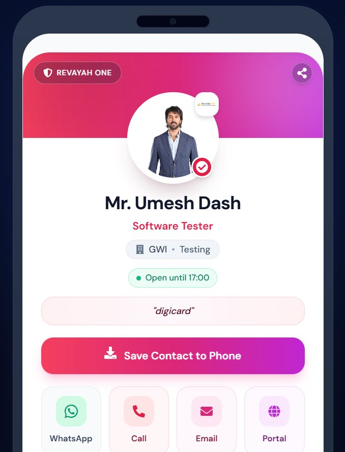
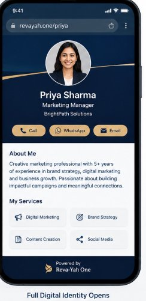

# DigiCard Platform: UX & Visual Design Review

> **Subject**: Comparative UX/UI audit between current platform implementation (Image 1) and the target executive reference (Image 2).  
> **Target Experience**: Revayah One Digital Identity Card (`revayah.one/:slug`)

---

## Visual Comparison

````carousel

<!-- slide -->

````

---

## 1. Executive UX Scorecard

| UX Dimension | Current Platform (Image 1) | Target Reference (Image 2) | Verdict / Gap |
| :--- | :--- | :--- | :--- |
| **Aesthetic Tone** | Bubblegum / Neon gradient (Fuchsia, Pink, Lime, Lavender) | Luxury Corporate (Midnight Navy `#0B1E36`, Champagne Gold `#D8B48D`, Crisp White) | **Current feels casual/informal; Reference feels authoritative, executive, and trustworthy.** |
| **Typographical Hierarchy** | Fragmented across 4 stacked colored pills under the name | Clean linear hierarchy: Name (H1) → Title (H2) → Organization (H3) | **Current forces vertical zig-zag scanning; Reference guides eye in <1.2s.** |
| **Avatar Presentation** | Small avatar half-cut by header, crowded by 2 floating badge overlays | Centered, prominent avatar framed with crisp white halo on dark background | **Reference highlights the person; Current hides the portrait behind decorative banners.** |
| **CTA Ergonomics** | Giant "Save Contact" button dominates before any bio/services are shown | Contact actions (Call, WhatsApp, Email) grouped in a sleek uniform strip | **Reference prioritizes immediate engagement; Current pushes contact saving prematurely.** |
| **Information Density** | Wastes above-the-fold space on pill badges and oversized buttons | Seamless transition into "About Me" summary and modular 2×2 "Services" grid | **Reference delivers immediate value; Current shows almost no professional substance.** |
| **Visual Cohesion** | 6+ competing accent colors with varied border radii and shadows | Strict 3-color palette with uniform pill radius (`rounded-full` / `rounded-2xl`) | **Reference provides calm, premium polish.** |

---

## 2. Why the Reference Feels So "Neat"

### 2.1 The Two-Tone "Hero Canvas" Architecture
The reference divides the card into two distinct spatial zones:
1. **The Executive Stage (Dark Top Canvas)**:
   - Deep Midnight Blue (`#0B1E36` / `#0A192F`) acts as a luxury backdrop.
   - White typography and portrait photography instantly pop with high optical contrast (WCAG AAA compliant).
   - A single diagonal golden hairline creates subtle dynamic tension without clutter.
2. **The Professional Dossier (White Bottom Canvas)**:
   - Clean, breathable card body where reading long text (About Me) and scanning offerings (My Services) feels natural on a white surface.

In contrast, the current platform uses a 50% split where the avatar sits awkwardly on the dividing line, with multiple floating badges and a stark hot-pink gradient that strains the eyes.

```mermaid
graph LR
    subgraph Current Platform: Fragmented Eye Flow
        A1[Fuchsia Gradient Banner] --> B1[Small Avatar + 2 Overlapping Badges]
        B1 --> C1[Name: Black Text]
        C1 --> D1[Pink Title Text]
        D1 --> E1[Grey Pill: Company + Dept]
        E1 --> F1[Green Pill: Hours]
        F1 --> G1[Peach Pill: Tagline Quotes]
        G1 --> H1[Giant Pink Save Button]
        H1 --> I1[4-Color Pastel Contact Tiles]
    end

    subgraph Reference Design: Smooth Linear Eye Flow
        A2[Midnight Blue Stage] --> B2[Crisp Portrait Avatar]
        B2 --> C2[White Name & Soft Silver Title]
        C2 --> D2[Unified Gold Contact Strip: Call | WA | Email]
        D2 --> E2[White Dossier Canvas]
        E2 --> F2[About Me Paragraph]
        F2 --> G2[2x2 Modular Services Grid]
    end
```

---

## 3. Detailed UX Anti-Patterns in Current Platform

### 3.1 Badge Overload ("Chip Fatigue")
Under the name `Mr. Umesh Dash`, the current card stacks 4 different pill containers:
1. `Software Tester` (colored text)
2. `🏢 GWI • Testing` (grey background pill with emoji)
3. `🟢 Open until 17:00` (green background pill with green dot)
4. `"digicard"` (peach background pill with quotation marks)

> [!WARNING]
> Stacking multiple pill badges with different background colors creates cognitive friction. Users perceive each box as an interactive button rather than metadata, diluting focus.

**Fix**: Adopt clean text hierarchy:
```html
<h1 className="text-xl font-bold text-white">Mr. Umesh Dash</h1>
<p className="text-sm font-medium text-slate-300">Software Tester</p>
<p className="text-xs text-amber-200/90 font-medium tracking-wide">GWI Solutions • Testing</p>
```

---

### 3.2 Premature Primary CTA ("Save Contact to Phone")
In Image 1, the largest button on the screen is **"Save Contact to Phone"**, placed before the viewer even knows who the person is, what they do, or what services they provide.

* **User Intent Reality**: When a prospect opens a digital business card via QR code or NFC tap, their immediate goal is:
  1. *Verify*: "Is this the right person?"
  2. *Connect*: "Can I message them on WhatsApp or call them right now?"
  3. *Evaluate*: "What do they offer?"
* Saving to phone address book is a **secondary or trailing action**, not the primary initial gesture.
* In Image 2, the primary actions are the 3 immediate contact pills (`Call`, `WhatsApp`, `Email`), followed immediately by the professional value proposition (**About Me** and **Services**).

---

### 3.3 Palette Discordance (The "Candy Shop" Effect)
The current platform mixes:
- Hot Fuchsia/Pink (`#e11d48` to `#ec4899`) in the header
- Emerald Green (`#10b981`) for the status badge
- Baby Green (`#dcfce7`) for the WhatsApp button
- Light Rose (`#ffe4e6`) for the Call & Email buttons
- Lilac Purple (`#f3e8ff`) for the Portal button
- Peach (`#ffedd5`) for the tagline pill

Having 6 distinct pastels and neons in a 300px vertical space makes the identity feel like a casual gaming or social app rather than a high-end corporate identity.

The reference strictly adheres to a **60-30-10 Design Rule**:
- **60% Base**: Deep Midnight Navy (Hero) & Crisp White (Body)
- **30% Secondary**: Charcoal Slate (`#1e293b`) for text & subtle card borders
- **10% Accent**: Warm Champagne / Camel Gold (`#D8B48D`) for action buttons and branding accents

---

## 4. Step-by-Step UI Refactoring Blueprint

To elevate the current card to match the clean reference aesthetic, apply the following layout structure in `digicard-fe/src/components/Cardstyles/ModernCard.jsx`:

### 4.1 Executive Hero Component Blueprint
```jsx
{/* TOP STAGE: Deep Midnight Navy Canvas */}
<div className="relative bg-[#0B1E36] px-6 pt-10 pb-8 text-center rounded-t-3xl overflow-hidden">
  
  {/* Subtle Gold Accent Line */}
  <div className="absolute top-1/3 left-0 w-full h-[1px] bg-gradient-to-r from-transparent via-[#D8B48D]/40 to-transparent pointer-events-none" />

  {/* Centered Avatar with Crisp White Ring Halo */}
  <div className="relative inline-block mx-auto mb-4">
    <div className="w-28 h-28 rounded-full p-1 bg-white/20 shadow-xl backdrop-blur-sm">
      
    </div>
  </div>

  {/* Clean Typography Hierarchy (No pill overload) */}
  <h1 className="text-2xl font-bold text-white tracking-tight">
    {profile.name}
  </h1>
  <p className="text-sm font-medium text-slate-200 mt-1">
    {profile.jobTitle || 'Professional'}
  </p>
  <p className="text-xs font-semibold text-[#D8B48D] tracking-wide mt-0.5">
    {profile.companyName || 'Revayah One'}
  </p>

  {/* Unified Champagne/Gold Quick Action Bar */}
  <div className="flex items-center justify-center gap-3 mt-6">
    <button
      onClick={() => handleCall(primaryPhone)}
      className="flex-1 max-w-[100px] flex items-center justify-center gap-1.5 py-2 px-3 rounded-full bg-[#E5C39E] hover:bg-[#d8b48d] text-[#0B1E36] font-semibold text-xs shadow-sm transition-transform active:scale-95"
    >
      <FaPhoneAlt className="w-3 h-3" />
      <span>Call</span>
    </button>

    <button
      onClick={() => handleWhatsApp(primaryPhone)}
      className="flex-1 max-w-[110px] flex items-center justify-center gap-1.5 py-2 px-3 rounded-full bg-[#E5C39E] hover:bg-[#d8b48d] text-[#0B1E36] font-semibold text-xs shadow-sm transition-transform active:scale-95"
    >
      <FaWhatsapp className="w-3.5 h-3.5" />
      <span>WhatsApp</span>
    </button>

    <button
      onClick={() => handleEmail(primaryEmail)}
      className="flex-1 max-w-[100px] flex items-center justify-center gap-1.5 py-2 px-3 rounded-full bg-[#E5C39E] hover:bg-[#d8b48d] text-[#0B1E36] font-semibold text-xs shadow-sm transition-transform active:scale-95"
    >
      <FaEnvelope className="w-3 h-3" />
      <span>Email</span>
    </button>
  </div>
</div>
```

---

### 4.2 Professional Dossier (White Body) Blueprint
```jsx
{/* BODY DOSSIER: Crisp White Canvas */}
<div className="bg-white px-6 py-6 space-y-6 rounded-b-3xl text-left">
  
  {/* Section: About Me */}
  {profile.aboutText && (
    <div className="space-y-2">
      <h2 className="text-base font-bold text-[#0B1E36] tracking-tight">
        About Me
      </h2>
      <p className="text-xs text-slate-600 leading-relaxed font-normal">
        {profile.aboutText}
      </p>
    </div>
  )}

  {/* Section: My Services (2x2 Modular Grid) */}
  {services.length > 0 && (
    <div className="space-y-3">
      <h2 className="text-base font-bold text-[#0B1E36] tracking-tight">
        My Services
      </h2>
      <div className="grid grid-cols-2 gap-2.5">
        {services.map((srv, idx) => (
          <div
            key={idx}
            className="flex items-center gap-2.5 p-3 rounded-xl bg-slate-50 border border-slate-100 hover:border-slate-200 transition-all shadow-sm"
          >
            <span className="text-[#0B1E36] text-sm">
              {srv.icon || '🎯'}
            </span>
            <span className="text-xs font-semibold text-slate-700 truncate">
              {srv.name}
            </span>
          </div>
        ))}
      </div>
    </div>
  )}

  {/* Secondary Action: Save Contact (Understated & Elegant) */}
  <div className="pt-2">
    <button
      onClick={handleSaveContact}
      className="w-full flex items-center justify-center gap-2 py-3 px-4 rounded-xl border border-slate-200 hover:bg-slate-50 text-slate-700 font-semibold text-xs transition-colors"
    >
      <FaDownload className="w-3.5 h-3.5 text-slate-500" />
      <span>Save Contact (.vcf)</span>
    </button>
  </div>

  {/* Footer: Powered by Revayah One */}
  <div className="pt-4 pb-2 text-center border-t border-slate-100">
    <div className="inline-flex items-center gap-1.5 text-[11px] font-medium text-slate-500">
      
      <span>Powered by <strong className="text-slate-800">Reva-Yah One</strong></span>
    </div>
  </div>
</div>
```

---

## 5. Summary Recommendation

1. **Adopt the Executive Palette**: Replace the hot fuchsia gradient with the **Midnight Navy + Champagne Gold + Clean White** color harmony.
2. **De-clutter the Identity Zone**: Eliminate the 4 stacked colored pills; present Name, Job Title, and Company with clean typography.
3. **Harmonize Action Buttons**: Use uniform gold pill buttons (`Call`, `WhatsApp`, `Email`) with dark text and icons.
4. **Elevate Content Above CTAs**: Place **About Me** and **Services** immediately below the contact strip, and relegate "Save Contact to Phone" to an elegant utility button at the base of the card.

