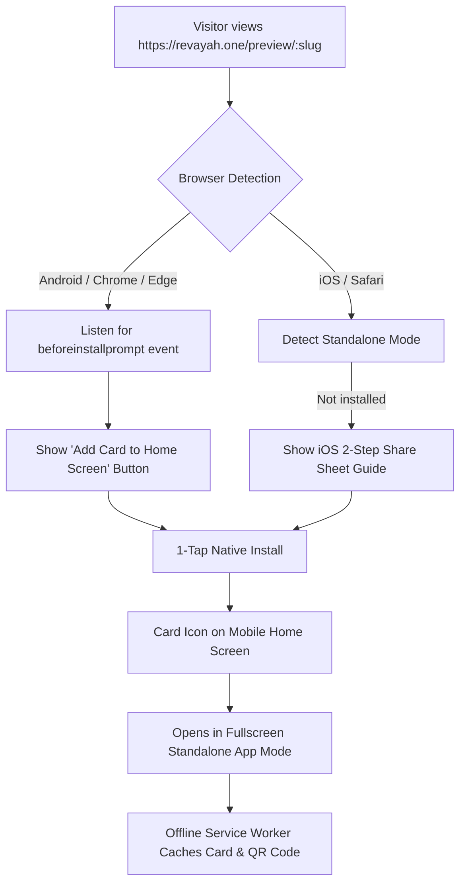

# DigiCard Platform: Progressive Web App (PWA) & Mobile Installation Architecture

> **Feature**: 1-Tap Home Screen Installation ("Add Card to Phone"), Dynamic Personalized Manifests, Full-Screen Native App Feel, and Offline Networking for Digital Cards.

---

## 1. Overview & Value Proposition

When a cardholder or their contact views a digital identity card on mobile, asking them to download a 50MB native mobile app from the Google Play Store or Apple App Store introduces severe drop-off.

By transforming Revayah One cards into a **Progressive Web App (PWA)**:
1. **Zero App Store Friction**: Installs in 1 second directly from the web browser.
2. **Personalized App Icon & Name**: The installed icon on their home screen is the **cardholder's own portrait photo or company logo**, named **"Priya's Card"**.
3. **Native Fullscreen Experience**: Opens in `standalone` mode—eliminating the browser address bar, back/forward buttons, and tab chrome.
4. **Offline Resilience**: Even underground, in an elevator, or at an outdoor expo with zero cellular signal, the card opens instantly, displaying the QR code and contact details.



---

## 2. Core Technical Architecture

### 2.1 Dynamic Web App Manifest per Card
Standard PWAs have a static `manifest.json`. For digital business cards, each card requires a **dynamic manifest** customized to the individual cardholder:

* **Endpoint**: `GET /api/v1/card-routes/manifest/:urlSlug`
* **Response Header**: `Content-Type: application/manifest+json; charset=utf-8`
* **JSON Payload**:
```json
{
  "name": "Priya Sharma - Digital Identity Card",
  "short_name": "Priya's Card",
  "description": "Marketing Manager at BrightPath Solutions. Tap to connect via WhatsApp, Call, or Email.",
  "start_url": "/preview/priya?source=pwa",
  "scope": "/",
  "display": "standalone",
  "orientation": "portrait",
  "background_color": "#0B1E36",
  "theme_color": "#0B1E36",
  "icons": [
    {
      "src": "https://digicard.blob.core.windows.net/cards/profilePhoto-priya-192.png",
      "sizes": "192x192",
      "type": "image/png",
      "purpose": "any maskable"
    },
    {
      "src": "https://digicard.blob.core.windows.net/cards/profilePhoto-priya-512.png",
      "sizes": "512x512",
      "type": "image/png",
      "purpose": "any maskable"
    }
  ]
}
```

---

### 2.2 Client-Side Dynamic Manifest Injection
On the frontend (`digicard-fe`), when `PreviewCard.jsx` loads a card by `:urlSlug`, it updates the manifest link in the DOM:

```javascript
// Dynamically attach personalized manifest to document head
useEffect(() => {
  if (cardData?.urlSlug) {
    let manifestLink = document.querySelector('link[rel="manifest"]');
    if (!manifestLink) {
      manifestLink = document.createElement('link');
      manifestLink.rel = 'manifest';
      document.head.appendChild(manifestLink);
    }
    manifestLink.href = `${API_URL}/api/v1/card-routes/manifest/${cardData.urlSlug}`;
  }
}, [cardData?.urlSlug]);
```

---

### 2.3 Service Worker (`sw.js`): Offline Networking & Cache Strategy
A lightweight Service Worker ensures the card loads instantly, even without an internet connection:

1. **Static Shell Assets**: Cache CSS, Satoshi/DM Sans fonts, icons, and logo on install (`cache-first`).
2. **Card API & Images**: Use `stale-while-revalidate` for `/api/v1/card-routes/share/:slug` and Azure Blob profile images.
3. **vCard Offline Storage**: The vCard `.vcf` file is generated locally in memory via `vcard.js`, so "Save Contact to Phone" always functions offline.

---

### 2.4 Installation Prompts (Android vs. iOS)

#### A. Android / Desktop Chrome (`beforeinstallprompt`)
```javascript
const [deferredPrompt, setDeferredPrompt] = useState(null);
const [isInstallable, setIsInstallable] = useState(false);

useEffect(() => {
  const handler = (e) => {
    e.preventDefault();
    setDeferredPrompt(e);
    setIsInstallable(true);
  };
  window.addEventListener('beforeinstallprompt', handler);
  return () => window.removeEventListener('beforeinstallprompt', handler);
}, []);

const handleInstall = async () => {
  if (!deferredPrompt) return;
  deferredPrompt.prompt();
  const { outcome } = await deferredPrompt.userChoice;
  if (outcome === 'accepted') {
    setIsInstallable(false);
  }
  setDeferredPrompt(null);
};
```

#### B. iOS / Safari Modal Guide
iOS Safari does not support `beforeinstallprompt`. Instead, we detect iOS and show an elegant bottom sheet modal:
1. Tap the **Share icon** (`?` with up arrow) in the Safari toolbar.
2. Scroll down and tap **"Add to Home Screen"** (`?`).
3. Tap **"Add"** in the top-right corner.

---

## 3. Implementation Checklist

- [ ] **Backend Manifest Endpoint**: Add `getCardManifest` in `card-controller.js` returning JSON with custom name, avatar icons, and standalone display.
- [ ] **Mount Route**: Add `GET /manifest/:urlSlug` in `card-routes.js`.
- [ ] **Frontend Service Worker**: Add `sw.js` in `public/` and register in `main.tsx`.
- [ ] **PWA Install Component**: Add `<PwaInstallButton />` in `PreviewCard.jsx` supporting both native prompt and iOS guide sheet.
- [ ] **Standalone Mode Awareness**: Hide the install button when the app is already running in standalone mode (`window.matchMedia('(display-mode: standalone)').matches`).
