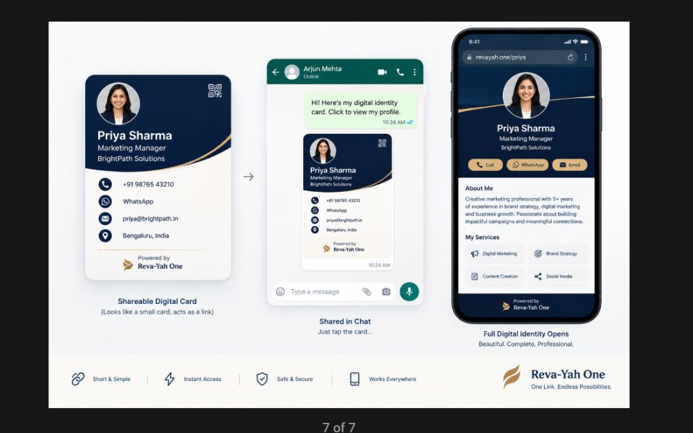
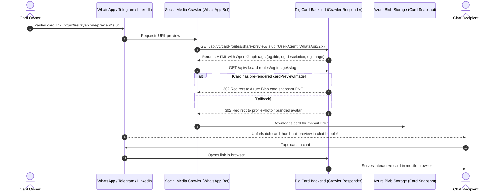

# Implementation Plan: Rich WhatsApp Chat Unfurl (Open Graph Meta & Card Thumbnail Preview)

> **Goal**: When any digital business card URL is shared on WhatsApp, Telegram, LinkedIn, X (Twitter), iMessage, or Slack, the chat automatically unfurls a rich preview with the miniature card thumbnail, person's name, job title, company, and description.

---

## Visual Target: Chat Unfurl Flow





---

## User Review Required

> [!IMPORTANT]
> **Crawler Traffic Routing Mechanism**:
> Since `digicard-fe` is a client-side Single Page Application (SPA), WhatsApp's crawler (`WhatsApp/2.x`, `facebookexternalhit/1.1`) cannot run JavaScript to read page metadata. We provide two bulletproof mechanisms:
> 1. **Vercel / Cloudflare Crawler Rewrite** (`digicard-fe/vercel.json`): Any request to `/preview/:slug` or `/:slug` whose `User-Agent` matches social crawlers (`WhatsApp`, `facebookexternalhit`, `Twitterbot`, `TelegramBot`, `LinkedInBot`, `Slackbot`) is automatically routed to the backend's Open Graph endpoint.
> 2. **Direct Smart Link** (`GET /p/:slug` on backend): If accessed directly, bots get OG meta tags; humans are instantly redirected (HTTP 302) to the full web card.

---

## Open Questions

> [!NOTE]
> 1. **Default Unfurl Description**:  
>    Proposed format:  
>    **Title**: `${Full Name} | ${Job Title || 'Digital Business Card'}` (e.g., `Priya Sharma | Marketing Manager`)  
>    **Description**: `${Company Name} • Digital Identity Card on Revayah One. Connect via Call, WhatsApp, Email, and view services.`  
>    *Does this match your desired branding?*
>
> 2. **Pre-rendering Card Thumbnails**:  
>    We will capture the compact card thumbnail in the frontend using `html-to-image` (already installed) and upload it to Azure Blob Storage on card save/preview as `card.cardPreviewImage`. This guarantees 100% fidelity to your design and sub-50ms crawler response times.  
>    *Are you happy with this Azure Blob caching strategy?*

---

## Proposed Changes

---

### 1. Backend (`digicard-be`)

#### [MODIFY] `src/models/card.model.js`
Add `cardPreviewImage` field to the schema to store the URL of the generated compact card thumbnail in Azure Blob Storage:
```javascript
// Add to cardSchema in src/models/card.model.js
cardPreviewImage: { 
  type: String, 
  default: null 
},
```

#### [NEW] `src/utils/crawler-detector.js`
Utility to identify social media crawlers by `User-Agent`:
```javascript
const CRAWLER_PATTERNS = [
  /facebookexternalhit/i,
  /WhatsApp/i,
  /Twitterbot/i,
  /LinkedInBot/i,
  /TelegramBot/i,
  /Slackbot/i,
  /Discordbot/i,
  /Applebot/i,
  /SkypeUriPreview/i
];

exports.isSocialCrawler = (userAgent) => {
  if (!userAgent) return false;
  return CRAWLER_PATTERNS.some((pattern) => pattern.test(userAgent));
};
```

#### [MODIFY] `src/controllers/card-controller.js`
Add two controllers:
1. `getCardSharePreview`:
   - Looks up card by `urlSlug` (or `_id`).
   - If crawler: returns HTML with Open Graph and Twitter Card `<meta>` tags.
   - If human browser: issues HTTP 302 redirect to `${FRONTEND_URL}/preview/${urlSlug}`.
2. `getCardOgImage`:
   - If `card.cardPreviewImage` exists: 302 redirects to Azure Blob image.
   - If `card.profilePhoto` exists: 302 redirects to `profilePhoto`.
   - Fallback: redirects to Revayah One logo.

```javascript
exports.getCardSharePreview = async (req, res) => {
  try {
    const { urlSlug } = req.params;
    const userAgent = req.headers['user-agent'] || '';
    const isBot = isSocialCrawler(userAgent);

    const card = await Card.findOne({ urlSlug }).lean();
    if (!card) {
      return res.status(404).send('Card not found');
    }

    const frontendUrl = process.env.FRONTEND_URL || 'https://www.revayah.one';
    const backendUrl = process.env.BACKEND_URL || `${req.protocol}://${req.get('host')}`;
    const targetUrl = `${frontendUrl}/preview/${urlSlug}`;

    if (!isBot) {
      // Normal human visitor -> redirect straight to interactive card
      return res.redirect(302, targetUrl);
    }

    // Social Crawler (WhatsApp, Telegram, LinkedIn, etc.) -> Serve OG metadata
    const fullName = `${card.prefix ? card.prefix + ' ' : ''}${card.firstName || ''} ${card.lastName || ''}`.trim() || 'Professional';
    const jobTitle = card.jobTitle || 'Digital Business Card';
    const company = card.companyName || card.organization || 'Revayah One';
    const ogTitle = `${fullName} | ${jobTitle}`;
    const ogDesc = `${company} • Digital Identity Card on Revayah One. Tap to connect via Call, WhatsApp, Email, and view services.`;
    const ogImage = card.cardPreviewImage || `${backendUrl}/api/v1/card-routes/og-image/${urlSlug}`;

    const html = `<!DOCTYPE html>
<html lang="en">
<head>
  <meta charset="utf-8" />
  <title>${ogTitle}</title>
  <meta property="og:site_name" content="Revayah One" />
  <meta property="og:type" content="profile" />
  <meta property="og:title" content="${ogTitle}" />
  <meta property="og:description" content="${ogDesc}" />
  <meta property="og:image" content="${ogImage}" />
  <meta property="og:image:secure_url" content="${ogImage}" />
  <meta property="og:image:type" content="image/png" />
  <meta property="og:image:width" content="600" />
  <meta property="og:image:height" content="600" />
  <meta property="og:url" content="${targetUrl}" />
  <meta name="twitter:card" content="summary_large_image" />
  <meta name="twitter:title" content="${ogTitle}" />
  <meta name="twitter:description" content="${ogDesc}" />
  <meta name="twitter:image" content="${ogImage}" />
</head>
<body>
  <p>Redirecting to <a href="${targetUrl}">${targetUrl}</a>...</p>
  <script>window.location.replace("${targetUrl}");</script>
</body>
</html>`;

    res.set('Content-Type', 'text/html');
    res.set('Cache-Control', 'public, max-age=300'); // Cache for 5 mins
    return res.status(200).send(html);
  } catch (error) {
    console.error('Error in getCardSharePreview:', error);
    res.status(500).send('Internal server error');
  }
};
```

#### [MODIFY] `src/routes/card-routes.js`
Mount endpoints:
- `router.get('/share-preview/:urlSlug', cardController.getCardSharePreview);`
- `router.get('/og-image/:urlSlug', cardController.getCardOgImage);`
- Add root short-link route in `index.js`: `app.get('/p/:urlSlug', cardController.getCardSharePreview);`

---

### 2. Frontend (`digicard-fe`)

#### [NEW] `src/components/Cardstyles/MiniCardSnapshot.jsx`
Compact 340×340 (or 600×600) snapshot component matching Screen 1 in the reference:
- Dark Midnight Navy Stage (`#0B1E36`):
  - Centered avatar with crisp white ring
  - Dynamic QR code pointing to live URL
  - Name, Job Title, Company Name
  - Golden hairline divider curve
- Light bottom stage:
  - Phone, WhatsApp, Email, Location
  - "Powered by Reva-Yah One" logo
- Designed to be captured off-screen by `html-to-image`.

#### [MODIFY] `src/pages/Card/PreviewCard.jsx`
1. **Auto-Generate & Upload Thumbnail**:
   When card data loads in `PreviewCard.jsx`, if `!cardData.cardPreviewImage`, an off-screen `<MiniCardSnapshot />` is captured using `toPng` and sent via `PUT /api/v1/card-routes/update-card/:id` with `cardPreviewImage` saved to Azure Blob.
2. **Enhanced WhatsApp Share Action**:
   Update WhatsApp sharing button to share:
   ```javascript
   const shareUrl = `${window.location.origin}/preview/${cardData.urlSlug}`;
   const message = encodeURIComponent(`Hi! Here's my digital identity card. Click to view my profile: ${shareUrl}`);
   window.open(`https://wa.me/?text=${message}`, '_blank');
   ```

#### [MODIFY] `vercel.json`
Add social crawler rewrite rules so when WhatsApp crawler hits `https://revayah.one/preview/:urlSlug`, it proxies directly to the backend Open Graph endpoint:
```json
{
  "rewrites": [
    {
      "source": "/preview/:urlSlug",
      "has": [
        {
          "type": "header",
          "key": "user-agent",
          "value": ".*(WhatsApp|facebookexternalhit|Twitterbot|LinkedInBot|TelegramBot|Slackbot|Discordbot).*"
        }
      ],
      "destination": "https://api.revayah.one/api/v1/card-routes/share-preview/:urlSlug"
    },
    {
      "source": "/(.*)",
      "destination": "/index.html"
    }
  ]
}
```

---

## Verification Plan

### Automated Verification
1. **Crawler Emulation Test**:
   ```bash
   # Test WhatsApp bot request
   curl -I -A "WhatsApp/2.21.12.21 N" "http://localhost:3000/api/v1/card-routes/share-preview/priya"
   # Expected: HTTP 200 with Content-Type: text/html and Open Graph meta tags

   # Test Human Browser request
   curl -I -A "Mozilla/5.0 (iPhone; CPU iPhone OS 17_0 like Mac OS X)" "http://localhost:3000/api/v1/card-routes/share-preview/priya"
   # Expected: HTTP 302 Redirect to http://localhost:5173/preview/priya
   ```

2. **OG Image Endpoint Test**:
   ```bash
   curl -I "http://localhost:3000/api/v1/card-routes/og-image/priya"
   # Expected: HTTP 302 redirect to Azure Blob image or valid image response
   ```

3. **Frontend Build**:
   ```bash
   npm --prefix digicard-fe run build
   # Expected: Exit code 0
   ```

### Manual Verification
1. Paste `https://revayah.one/preview/:slug` into:
   - **WhatsApp Web / Mobile**: Verify chat bubble unfurls the card thumbnail, name, and description.
   - **Telegram / LinkedIn / Twitter**: Verify the rich card preview tile appears.
2. Click the unfurled card in chat: Verify it immediately opens the live digital card in the browser.

